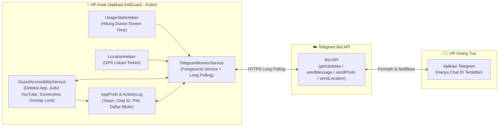

# Implementation Plan: KidGuard — Sistem Monitoring & Kontrol HP Anak via Telegram

Aplikasi Android native berbasis **Kotlin** yang berjalan di HP anak dan terhubung langsung ke **Telegram Bot API** (tanpa perlu sewa server/VPS). Orang tua dapat memantau aktivitas secara *real-time* dan mengirim perintah kontrol langsung dari chat Telegram.

---

## 1. Arsitektur Sistem



> [!IMPORTANT]
> **Keamanan Akses (Whitelist Chat ID):** Bot hanya akan memproses perintah yang berasal dari `Parent Chat ID` yang didaftarkan saat setup di HP anak. Pesan dari pengguna Telegram lain akan ditolak secara otomatis.

---

## 2. Daftar Fitur & Perintah Bot Telegram

Orang tua dapat mengontrol aplikasi menggunakan tombol menu cepat (*Reply Keyboard*) maupun perintah teks:

| Perintah / Tombol | Fungsi Utama | Mekanisme Teknis di Android |
| :--- | :--- | :--- |
| **`/start`** / **`/menu`** | Menampilkan papan tombol cepat di Telegram | Mengirim `ReplyKeyboardMarkup` agar tidak perlu ketik manual |
| **`/status`** | Info *real-time*: aplikasi yang sedang dibuka, judul YouTube yang ditonton, % baterai, status cas, & WiFi | Membaca state dari `GuardAccessibilityService` + `BatteryManager` |
| **`/yt`** / **`/riwayat`** | Menampilkan 15 riwayat video YouTube & aplikasi terakhir yang dibuka beserta jamnya | Membaca ring-buffer log harian dari penyimpanan lokal |
| **`/screentime`** | Rekap total durasi pemakaian per aplikasi/game hari ini | Query ke `UsageStatsManager` untuk rentang waktu 00:00 – sekarang |
| **`/ss`** | Mengambil *screenshot* layar HP anak saat itu juga dan mengirimnya ke chat | `AccessibilityService.takeScreenshot()` (Android 11+ tanpa pop-up izin berulang) |
| **`/lokasi`** | Mengirim titik GPS akurat + tautan Google Maps | `LocationManager` (GPS + Network Provider) -> `sendLocation` |
| **`/pesan <teks>`** | Memunculkan kotak peringatan di tengah layar HP anak + bunyi alarm singkat | `WindowManager` overlay (`TYPE_ACCESSIBILITY_OVERLAY`) |
| **`/lock`** & **`/unlock`** | Mengunci layar HP anak dengan tampilan *"Waktunya Istirahat / Belajar"* | Full-screen overlay di atas semua aplikasi kecuali panggilan darurat |
| **`/block <nama>`** | Memblokir aplikasi/game tertentu (contoh: `/block roblox`) | Mencocokkan nama aplikasi/package dan menutupnya dengan layar blokir |
| **`/unblock <nama>`** | Membuka kembali blokir aplikasi/game | Menghapus aplikasi dari daftar blokir aktif |

### Notifikasi Otomatis (Real-Time Alerts)
Selain menunggu perintah, HP anak akan otomatis mengirim pesan ke Telegram ketika:
1. **Buka Game / Aplikasi Pantauan**: Saat anak membuka game atau aplikasi baru (dilengkapi jeda *cooldown* agar tidak spam jika anak hanya berpindah layar sebentar).
2. **Nonton Video YouTube Baru**: Saat judul video yang diputar di aplikasi YouTube atau YouTube Kids berubah, bot langsung mengirimkan judul video tersebut.
3. **Baterai Lemah (< 15%)**: Memberi tahu orang tua jika baterai HP anak hampir habis.

---

## 3. Struktur Proyek (`D:\DEDEN_PROJECT\Monitoring Device Anak`)

Proyek akan dibuat sebagai proyek standar Android Studio (Gradle Kotlin DSL) yang siap di-*build* menjadi APK:

```text
D:\DEDEN_PROJECT\Monitoring Device Anak\
├── build.gradle.kts
├── settings.gradle.kts
├── gradle.properties
└── app\
    ├── build.gradle.kts
    └── src\main\
        ├── AndroidManifest.xml
        ├── res\
        │   ├── xml\
        │   │   ├── accessibility_service_config.xml
        │   │   └── device_admin_receiver.xml
        │   ├── layout\
        │   │   ├── activity_main.xml          # UI Setup & Checklist Izin (diproteksi PIN)
        │   │   ├── overlay_lock_screen.xml    # Tampilan layar saat di-/lock atau aplikasi diblokir
        │   │   └── overlay_parent_message.xml # Pop-up pesan dari orang tua (/pesan)
        │   └── values\
        │       ├── strings.xml
        │       └── themes.xml
        └── java\com\kidguard\app\
            ├── MainActivity.kt                # Layar setup Token, Chat ID, PIN, & status izin
            ├── data\
            │   ├── AppPrefs.kt                # Penyimpanan konfigurasi, PIN, daftar blokir, & log
            │   └── ActivityModels.kt          # Data model untuk log aplikasi & YouTube
            ├── service\
            │   ├── GuardAccessibilityService.kt # Deteksi app aktif, ekstraksi judul YouTube, screenshot, & blokir
            │   ├── TelegramMonitorService.kt  # Foreground service & long-polling Telegram Bot
            │   └── GuardDeviceAdminReceiver.kt # Mencegah anak uninstall aplikasi sembarangan
            ├── telegram\
            │   ├── TelegramClient.kt          # HTTP client (sendMessage, sendPhoto, sendLocation, getUpdates)
            │   └── BotCommandRouter.kt        # Parser & eksekutor perintah (/status, /ss, /lock, dll.)
            └── util\
                ├── UsageStatsHelper.kt        # Kalkulasi durasi pemakaian aplikasi harian
                ├── LocationHelper.kt          # Pengambilan koordinat GPS
                └── OverlayManager.kt          # Manajemen pop-up pesan & layar kunci
```

---

## 4. Detail Teknis Penting

### A. Cara Mendeteksi Judul Video YouTube & Game
- **Deteksi Aplikasi & Game**: `GuardAccessibilityService` menangkap event `TYPE_WINDOW_STATE_CHANGED`, membaca `packageName`, lalu mengubahnya menjadi nama aplikasi asli menggunakan `PackageManager.getApplicationLabel()`.
- **Ekstraksi Judul YouTube**: Saat `packageName` adalah `com.google.android.youtube` atau `com.google.android.apps.youtube.kids`, service melakukan pemindaian ringan pada struktur teks layar (`AccessibilityNodeInfo`) untuk mengambil judul video yang sedang tampil di pemutar utama, serta menyimpan perubahannya ke riwayat.

### B. Anti-Kill & Hemat Baterai
- Menggunakan `ForegroundService` dengan prioritas yang tepat dan meminta izin `REQUEST_IGNORE_BATTERY_OPTIMIZATIONS` saat setup awal.
- Koneksi Telegram menggunakan teknik **HTTP Long Polling (`timeout=25s`)**, sehingga tidak boros kuota maupun baterai ketika tidak ada pesan masuk.
- Dilengkapi `BOOT_COMPLETED` receiver agar service otomatis menyala kembali jika HP anak di-*restart*.

### C. Proteksi dari Anak (Anti-Tamper)
1. **PIN Lock di Aplikasi**: Jika anak membuka aplikasi KidGuard, yang muncul adalah layar masukkan PIN Orang Tua.
2. **Device Admin**: Opsional diaktifkan saat setup agar tombol *Uninstall* aplikasi terkunci di pengaturan Android.

---

## 5. Tahapan Pengerjaan

1. **Inisialisasi Project & Konfigurasi Gradle**: Membuat struktur project Android Kotlin, `AndroidManifest.xml`, dan konfigurasi izin.
2. **Penyimpanan & Utilitas (`AppPrefs`, `UsageStatsHelper`, `LocationHelper`, `OverlayManager`)**: Membangun modul pembaca durasi layar, GPS, penyimpanan log, dan tampilan overlay kunci/pesan.
3. **Inti Monitoring (`GuardAccessibilityService`)**: Implementasi deteksi aplikasi aktif, pembacaan judul YouTube, pemblokir aplikasi, dan fitur `takeScreenshot`.
4. **Koneksi Telegram (`TelegramClient`, `BotCommandRouter`, `TelegramMonitorService`)**: Implementasi komunikasi dua arah dengan Telegram Bot API dan notifikasi otomatis.
5. **UI Setup & Proteksi (`MainActivity`)**: Membuat tampilan setup Bot Token, Chat ID, PIN, serta tombol pintas pengaktifan izin.
6. **Panduan Pembuatan Bot & Instalasi APK**: Menyusun panduan langkah demi langkah cara mengambil Token dari `@BotFather`, cek Chat ID, dan menginstal ke HP anak.
